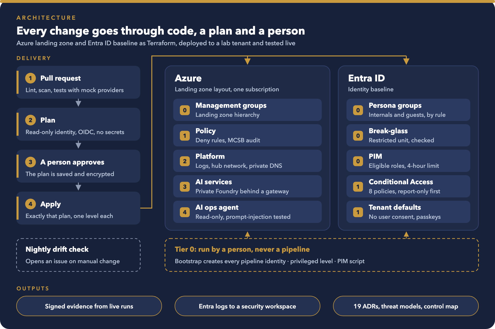

# Azure landing zone and Entra ID baseline as code

A right-sized Azure landing zone, an Entra ID security baseline and a secured AI services landing zone
with a prompt-injection-tested ops agent, for a regulated organisation of 300 to 1,000 staff. Everything is Terraform, delivered through gated
pipelines with no stored secrets, deployed to a lab tenant and tested live, with signed evidence.

New here? Read [the story](docs/architecture/story.md): the whole design in plain language, for anyone in
IT.

## For engineers

| Start with | It tells you |
|---|---|
| [How it works](docs/how-it-works.md) | One page: what is where, who runs it, how a change reaches Azure |
| [Quickstart](QUICKSTART.md) | Deploy your own copy in a new trial tenant, about AUD 3 a day on the free credit, then tear it down |
| [Runbooks](docs/runbooks/README.md) | Step by step, for each job |
| [Glossary](docs/glossary.md) | The words this repository uses |

## Architecture

More views (estate, identity tiers, change flow) are in the [architecture overview](docs/architecture/overview.md).
The image's source is [`architecture.svg`](docs/architecture/architecture.svg).

## Start here: five things worth a look

1. [Break-glass protection](entra/level-0-privileged/): two emergency accounts in a restricted
   administrative unit, with five checks that fail every plan if either stops working.
2. [The Graph permission deny list](entra/bootstrap/tests/graph.tftest.hcl): tests that no pipeline
   holds any permission that could grant itself more.
3. [Conditional Access as data](entra/level-1-ca/policies.tf): eight policies, one exclusion, report-only
   until each meets a written bar ([ADR-0017](docs/adr/0017-conditional-access-baseline.md)).
4. [The AI gateway threat model](docs/security/threat-model-ai.md): every threat has a control, and every
   control a live test, with the results in [`evidence/`](evidence/).
5. [Lessons learned](docs/lessons-learned.md): what broke, why, and the fix.

## Controls at a glance

| Area | Control | Decision |
|---|---|---|
| Delivery | OIDC federation only, no client secrets; read-only plan and single-level apply identities | [ADR-0012](docs/adr/0012-pipeline-identities-and-rbac-scope.md) |
| Delivery | Saved, encrypted plans applied only after a person approves; nightly drift detection | [ADR-0006](docs/adr/0006-solo-maintainer-approvals.md) |
| Identity | No pipeline holds a Tier 0 Graph permission; Tier 0 is run by a person | [ADR-0016](docs/adr/0016-entra-pipeline-identities-and-graph-permissions.md) |
| Identity | PIM: eligible admin roles, 4-hour Tier 0 activation with MFA and justification | [ADR-0019](docs/adr/0019-pim-applied-by-a-person-checked-by-terraform.md) |
| Identity | Users consent to nothing, restricted guests, passkeys on, SMS and voice off | [ADR-0018](docs/adr/0018-entra-tenant-governance-defaults.md) |
| Platform | Azure landing zone hierarchy; deny public IPs in corp; Microsoft cloud security benchmark | [Comparison](docs/architecture/alz-comparison.md) |
| AI | Foundry private only, no keys; gateway enforces identity, token limits and a kill switch | [ADR-0008](docs/adr/0008-gateway-enforced-by-identity.md) |
| Assurance | Signed evidence from live runs; controls mapped to Essential Eight, MCSB, ISM and CPS 234 | [Control mapping](docs/security/control-mapping.md) |

## Progress

| Phase | Content | State |
|---|---|---|
| 1 | Repository skeleton, naming, HCP Terraform root, PR gates | Done |
| 2 | Decisions and governance: ADRs, CODEOWNERS, PR template, governance runbook, licence | Done |
| 3 | Bootstrap and destroy workflows, verified costs | Done, apart from checking cost figures in the pricing calculator |
| 4 | Azure platform: management groups, policy, management, connectivity, DNS | Done, deployed 2026-11-15 |
| 4 | Entra ID baseline: pipeline identities, personas, break-glass, Conditional Access, tenant defaults, PIM | Done, deployed 2026-11-19 to 2026-11-22. Conditional Access is report-only until 2026-11-26 at the earliest |
| 5 | AI workload: threat model, Foundry, AI gateway, guardrails, ops agent | Done, deployed and tested live 2026-11-15 to 2026-11-18 |
| 6 | Architecture and control mapping | Done: [overview](docs/architecture/overview.md), [control mapping](docs/security/control-mapping.md), [identity threat model](docs/security/threat-model-identity.md) |
| Next | Maester tenant tests, break-glass FIDO2 keys and sign-in alert, enforcing Conditional Access | Planned |

The lab is torn down between sessions to control cost. See the [changelog](CHANGELOG.md) for what
changed when.

## Repository layout

| Path | Purpose |
|---|---|
| `bootstrap/` | One-off setup, run by a person: budget, pipeline identities, federated credentials, roles (`rbac.yaml`), GitHub environments, security log workspace |
| `tfc/` | HCP Terraform projects, workspaces and variable sets, from YAML |
| `modules/` | Small local modules where Azure Verified Modules do not fit |
| `azure/` | Azure platform levels 0-4 |
| `entra/` | Entra ID bootstrap (run by a person), levels 0-1, PIM, break-glass checks |
| `agents/` | The ops agent: Python, standard library only |
| `tests/` | Live tests: policy, AI gateway, ops agent |
| `evidence/` | Signed results from live deployments and tests |
| `docs/` | Architecture, ADRs, runbooks, security, cost, lessons learned |

## Key documents

| Document | What it answers |
|---|---|
| [The story](docs/architecture/story.md) | What this is and how it fits together, in plain language |
| [Architecture overview](docs/architecture/overview.md) | Diagrams: system, Azure estate, identity tiers, change flow |
| [ADR index](docs/adr/README.md) | Why each decision was made |
| [Comparison with the Azure landing zone](docs/architecture/alz-comparison.md) | What is left out of Microsoft's reference design, and why |
| [Control mapping](docs/security/control-mapping.md) | Which control supports which framework area, with code and tests |
| [AI threat model](docs/security/threat-model-ai.md) and [identity threat model](docs/security/threat-model-identity.md) | How it could be attacked, and what stops it |
| [Quickstart](QUICKSTART.md) | How to deploy your own copy for learning and testing, and tear it down |
| [Runbooks](docs/runbooks/README.md) | How to bootstrap, deploy, recover and tear down |
| [Cost](docs/cost.md) | What it costs, and the HCP resource count |
| [Naming](docs/naming.md) and [dependency graph](docs/architecture/dependency-graph.md) | Conventions and how levels connect |
| [Contributing](CONTRIBUTING.md) and [security policy](SECURITY.md) | How changes are made, and how to report a problem |

## Licence

Code and documentation are under the [MIT licence](LICENSE).

## Licensing notes for Microsoft features

Features that need Entra ID P2 or Workload Identities Premium are marked where they are used, and
are behind flags so the code still deploys without them.

## Scope

This is a personal lab built on my own tenant and subscription. It contains nothing from any employer.
Where it maps controls to regulatory frameworks, it says the design *supports* a control, never that it
*complies*.
