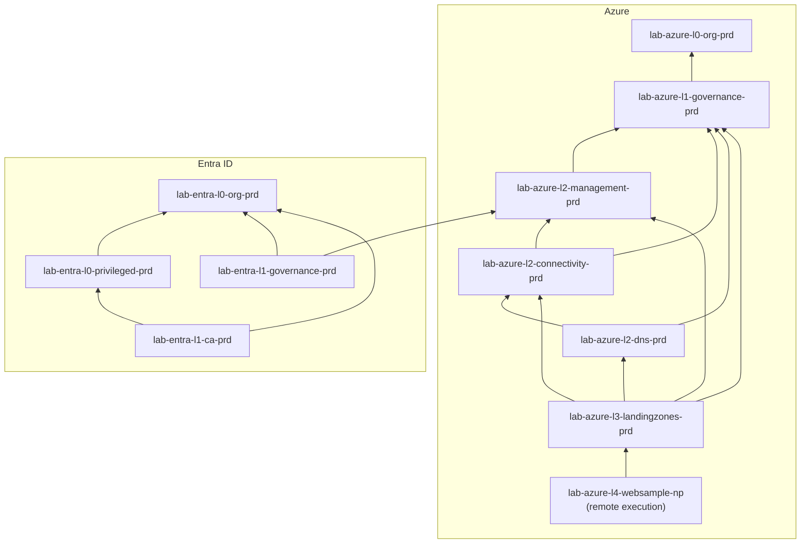

# Workspace dependency graph

Arrows point from a workspace to the workspace whose outputs it reads with `tfe_outputs`. The graph
mirrors the `reads` lists in `tfc/workspaces.yaml`; the `tfc/` tests reject a read from a higher
level within the same area.

The one cross-area edge, `lab-entra-l1-governance-prd` to `lab-azure-l2-management-prd`, exists
because Entra diagnostic settings send sign-in and audit logs to the platform Log Analytics workspace.
