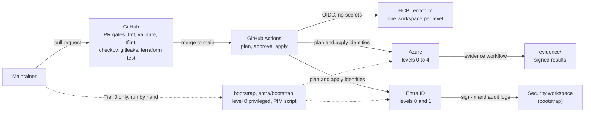
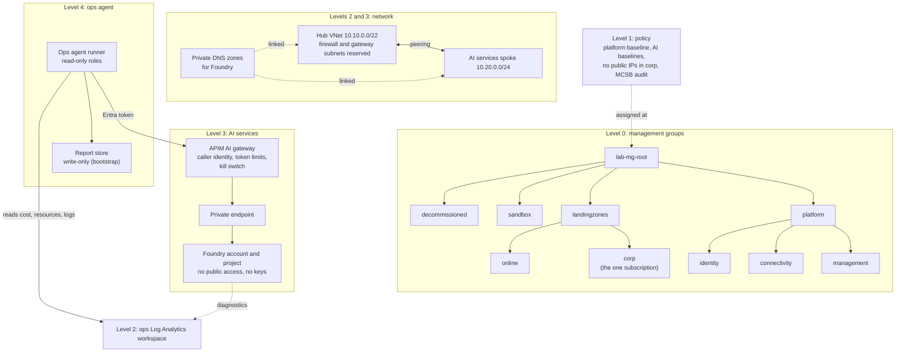
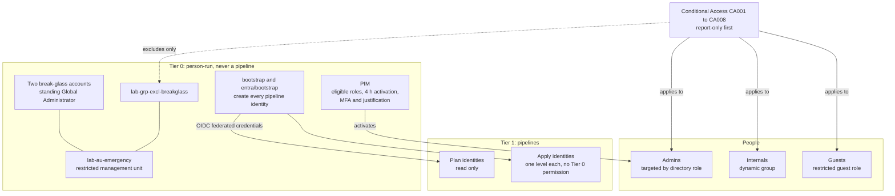
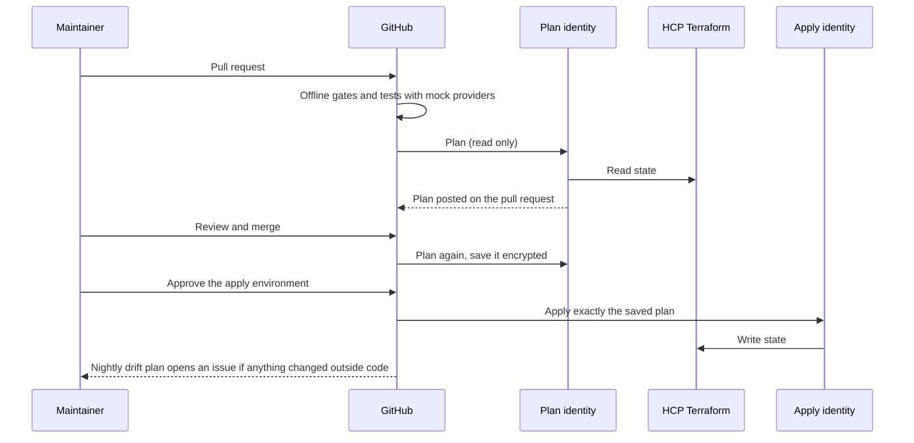

# Architecture overview

Four views of the same system. For the plain-language version, read [the story](story.md) first.

## 1. The whole system

Code in GitHub is the only way in. Pipelines plan with read-only identities, a person approves, and the
saved plan is applied. State lives in HCP Terraform, one workspace per level.

## 2. Azure estate

The Azure landing zone layout, shrunk to one subscription. Empty management groups cost nothing and keep
the full design visible.

## 3. Identity

Three tiers. Tier 0 can make someone Global Administrator, so only a person changes it. Pipelines hold
only what their level needs.

## 4. How a change reaches production

## Where to go next

| To understand | Read |
|---|---|
| Why each choice was made | [ADR index](../adr/README.md) |
| How workspaces depend on each other | [Dependency graph](dependency-graph.md) |
| What is left out of Microsoft's reference design, and why | [Comparison with the Azure landing zone](alz-comparison.md) |
| Which controls map to which frameworks | [Control mapping](../security/control-mapping.md) |
| How identity could be attacked | [Identity threat model](../security/threat-model-identity.md) |
